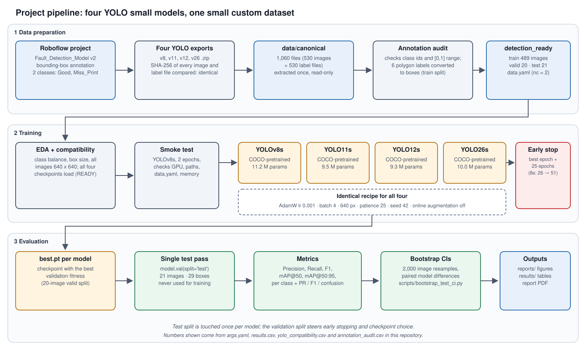
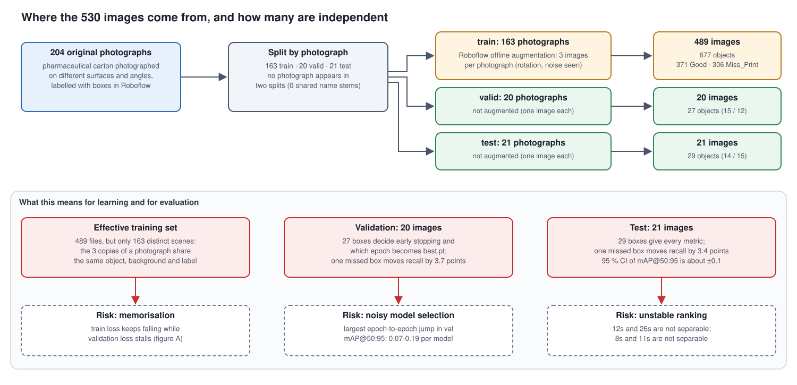
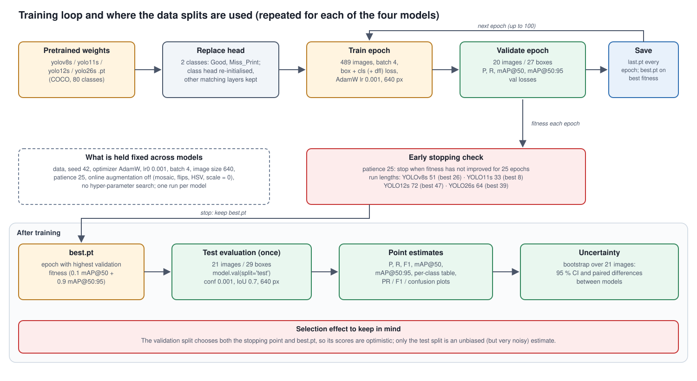
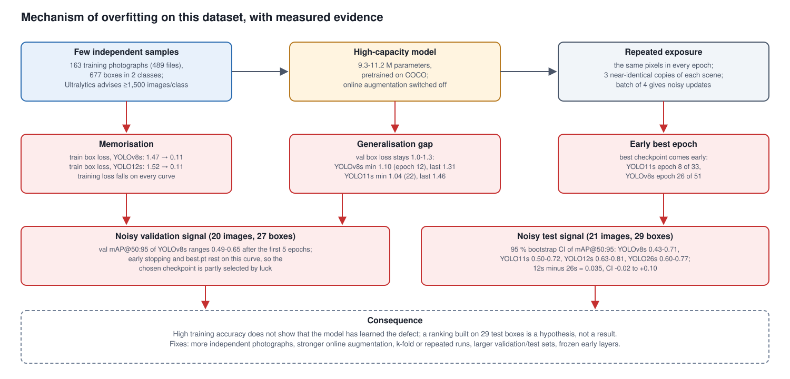

# Architecture

How the experiment is organised, from raw photographs to the report. Diagrams are in `docs/diagrams/` (SVG, editable; `docs/diagrams/src/make_diagrams.py` regenerates them).

## 1. End-to-end pipeline

| Stage | What happens | Where |
|---|---|---|
| Annotation | Photographs annotated with bounding boxes in Roboflow (`Fault_Detection_Model`, v2); classes `Good`=0, `Miss_Print`=1 | external |
| Export | Four exports (YOLOv8, YOLO11, YOLO12, YOLO26 formats) hashed; all identical, one kept | notebook |
| Validation | Class ids, coordinate ranges and degenerate boxes checked; 6 polygon labels converted to boxes | notebook, `data/annotation_audit.csv` |
| Training | Four COCO-pretrained small models, one recipe | `scripts/train.py`, `runs/` |
| Evaluation | Validation during training; one test pass per `best.pt` | `scripts/evaluate.py`, `results/` |
| Uncertainty | Image-level bootstrap of test metrics, paired across models | `scripts/bootstrap_test_ci.py`, `results/bootstrap/` |
| Analysis & report | Generalisation-gap, volatility and pairwise figures; LaTeX report | `scripts/make_analysis_figures.py`, `report/` |

## 2. Dataset split and augmentation

Only the training split is augmented offline (3 files per photograph), so 489 files represent 163 independent scenes. Validation (20) and test (21) contain one file per photograph. No photograph stem or byte-identical image occurs in two splits (`scripts/audit_split_leakage.py`).

## 3. Training and evaluation workflow

Per model: load the COCO-pretrained checkpoint, fine-tune with AdamW (lr 0.001), batch 4, 640 px, seed 42, online augmentation off, patience 25. Ultralytics keeps `best.pt` by validation fitness (0.1·mAP50 + 0.9·mAP50-95). `best.pt` is evaluated once on test.

## 4. Overfitting mechanism

Few independent scenes, high-capacity pretrained networks and repeated exposure to identical pixels lead to memorisation; validation and test are too small to detect it reliably, which makes early stopping and ranking noisy.

## 5. The four detectors (published facts)

| Model | Distinguishing design elements | Source |
|---|---|---|
| YOLOv8s | C2f blocks, anchor-free decoupled head | Ultralytics docs |
| YOLO11s | C3k2 blocks, C2PSA spatial attention | Ultralytics docs |
| YOLO12s | Area attention, R-ELAN, FlashAttention, 7×7 separable-conv position perceiver | Tian et al., arXiv:2502.12524 |
| YOLO26s | DFL removed, NMS-free one-to-one head, MuSGD optimiser, ProgLoss, STAL | Ultralytics docs; Chakrabarty, arXiv:2601.12882 (secondary review) |

Sources and access dates are listed in the report's source ledger.

## 6. Design decisions

* **Same recipe for all models** so differences are attributable to the model, not the settings; no hyper-parameter search.
* **Online augmentation off** to isolate the effect of the architecture under the offline-augmented data. This is also the main untested confound (no augmented baseline).
* **Test set touched once per model**; validation used for stopping and checkpoint selection.
* **Bootstrap over images, not boxes**, because boxes in one image are not independent.
