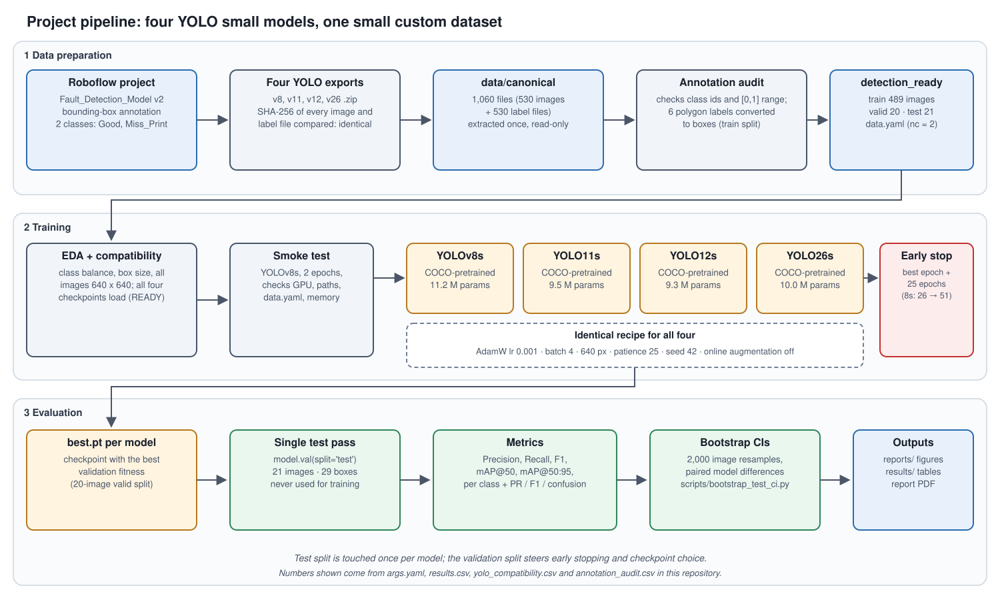

# Four small YOLO detectors on a 204-photograph dataset

Comparison of **YOLOv8s, YOLO11s, YOLO12s and YOLO26s** (Ultralytics 8.4.190) on a small custom Roboflow dataset of pharmaceutical-packaging cartons labelled **Good** or **Miss_Print**, with an honest look at what a 21-image test set can and cannot tell us, why small datasets fail and why the models overfit.



## Main findings

| Model | Precision | Recall | F1 | mAP@50 | mAP@50:95 | mAP@50:95 95 % bootstrap CI |
|---|---|---|---|---|---|---|
| YOLOv8s | 0.891 | 0.853 | 0.872 | 0.858 | 0.583 | [0.429, 0.713] |
| YOLO11s | 0.854 | 0.877 | 0.865 | 0.907 | 0.625 | [0.502, 0.720] |
| **YOLO12s** | 1.000 | 0.958 | 0.978 | 0.960 | 0.727 | [0.632, 0.807] |
| YOLO26s | 0.949 | 0.895 | 0.921 | 0.919 | 0.697 | [0.596, 0.774]* |

Test split: 21 photographs, 29 boxes. *The interval is built on the CPU re-evaluation (point 0.693); the table shows the value logged during training (GPU).

1. **Point estimates rank YOLO12s > YOLO26s > YOLO11s > YOLOv8s**, but intervals are about ±0.1 wide.
2. **Only a coarse statement survives resampling:** the two newer models beat the two older ones on mAP@50:95 (paired intervals exclude zero). YOLO12s vs YOLO26s (+0.035, [−0.022, +0.099]) and YOLOv8s vs YOLO11s are **not** separable.
3. **Overfitting is visible:** training box loss falls to 0.11–0.29 while validation box loss stays at roughly 1.0–1.6; best epochs are 26, 8, 47 and 39. YOLOv8s and YOLO11s lose 0.09–0.12 validation mAP@50:95 in the 25 patience epochs, YOLO12s and YOLO26s only 0.02–0.04.
4. **The dataset is smaller than it looks:** 489 training files come from 163 photographs (3 offline-augmented copies each). Validation has 20 and test 21 photographs. There is no photograph overlap between splits.

Read the full write-up: [`report/report.pdf`](report/report.pdf) (LaTeX source: [`report/report.tex`](report/report.tex)).

## Repository map

```
README.md  ARCHITECTURE.md  LICENSE  CITATION.cff  requirements.txt
report/        report.pdf, report.tex, references.bib, figures/
docs/          WORKING_PRINCIPLES.md DATASET.md EVALUATION.md OVERFITTING_AND_SMALL_DATA.md REPRODUCE.md
docs/diagrams/ four SVG diagrams (+PNG fallbacks) and their generator
scripts/       train.py evaluate.py predict.py bootstrap_test_ci.py audit_split_leakage.py make_analysis_figures.py
runs/          per-model results.csv, args.yaml, Ultralytics plots (training logs)
results/       tables/, bootstrap/, test_curves/
figures/       comparison/, eda/, analysis/
weights/       best.pt of every model (renamed <Model>_best.pt, 19-23 MB each)
notebooks/     original experiment notebook with outputs
data/          data.yaml.template, audit and class-distribution CSVs, README (images are not included)
```

## Quick start

```bash
python -m venv .venv && source .venv/bin/activate      # Windows: .venv\Scripts\activate
pip install -r requirements.txt
# 1. rebuild the dataset (see data/README.md), then
python scripts/audit_split_leakage.py --root data/detection_ready
# 2. use a trained model
python scripts/predict.py --weights weights/YOLO12s_best.pt --source path/to/images
# 3. re-evaluate and bootstrap
python scripts/bootstrap_test_ci.py --data data/detection_ready/data.yaml --split test --device cpu \
  --models YOLOv8s=weights/YOLOv8s_best.pt YOLO11s=weights/YOLO11s_best.pt \
           YOLO12s=weights/YOLO12s_best.pt YOLO26s=weights/YOLO26s_best.pt
# 4. retrain one model with the project's recipe
python scripts/train.py --model yolo12s.pt --name YOLO12s_LIVE --device 0
```

Full instructions: [docs/REPRODUCE.md](docs/REPRODUCE.md).

## Limitations (short)

One training run per model (no seed variance measured); 29 test boxes; all online augmentation was disabled by design and no ablation was run; one product and one defect family. Details in the report, section 7.

## Licence and attribution

Code: MIT (see `LICENSE`). Ultralytics is AGPL-3.0; models trained with it and distributed with this repository may carry AGPL obligations, so check before reuse. The dataset licence is set in the Roboflow project and is **not** covered here. The report was drafted with AI assistance (Claude, Anthropic) from the author's notebook and logs; numbers should be re-checked by the author before citing.
